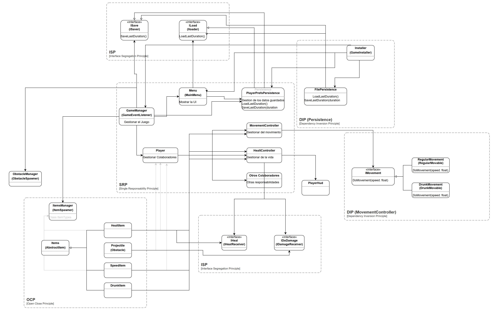

# SOLID y Clean Code en Unity

Pequeño juego 2D de Unity (esquivar obstáculos y recoger ítems) usado como ejercicio para aplicar los principios **SOLID**, **Inversión de Control** y prácticas de **Clean Code**.

## Mapa del proyecto

El diagrama muestra las clases del juego agrupadas por el principio que ilustra cada una.

[](docs/mapa-del-proyecto.png)

- [Ver el diagrama completo en PDF](Assets/Diagrama%20General%20Solid.pdf), que incluye además los ejemplos teóricos (LSP, OCP, IoC).

## Dónde se aplica cada principio

| Principio | Aplicación en el código |
|---|---|
| **SRP** | Cada clase tiene una sola responsabilidad: `Player` agrupa a los colaboradores, `HealtController` gestiona la vida, `MovementController` el movimiento, `PlayerHud` muestra la vida y `PlayerSoundController` reproduce los sonidos. |
| **OCP** | Los ítems heredan de `AbstractItems` y `ItemsSpawner` los instancia por `Id`. Añadir un ítem nuevo no obliga a modificar el spawner. |
| **LSP** | Los ejemplos de herencia frente a composición están en `Assets/Solid Examples and Inversion of Control`. |
| **ISP** | Interfaces pequeñas y específicas: `ILoader` y `ISaver` para persistencia, `IHealReceiver` y `IDamageReceiver` para vida y daño. |
| **DIP** | Las clases dependen de abstracciones: `MovementController` usa `IMovable` (`RegularMovable`, `DrunkMovable`), y el menú y el gestor de partida usan `ILoader` e `ISaver`. |
| **IoC** | `GameInstaller` es la raíz de composición: elige e inyecta las implementaciones (`FilePersistance` en el Editor, `PlayerPrefsPersistence` en el resto). |

Los efectos de sonido siguen el mismo enfoque: `HealtController` y `MovementController` exponen eventos (`Damaged`, `Healed`, `DrunkStarted`, `SpeedChanged`) y `PlayerSoundController` los escucha, de modo que la lógica de juego no sabe nada de audio.

## Clean Code

- Nombres que expresan la intención y métodos cortos con una sola tarea.
- Sin código comentado: los comentarios que quedan explican el porqué, no el qué.
- Las dependencias se inyectan con `Configure(...)` en lugar de crearse dentro de las clases.

## Estructura

```
Assets/
├── Scripts/                                    Código del juego
├── Audio/                                      Música y efectos de sonido
├── Scenes/                                     Escenas del juego
├── Solid Examples and Inversion of Control/    Ejemplos paso a paso de cada principio
└── Diagrama General Solid.*                    Mapa del proyecto
```
